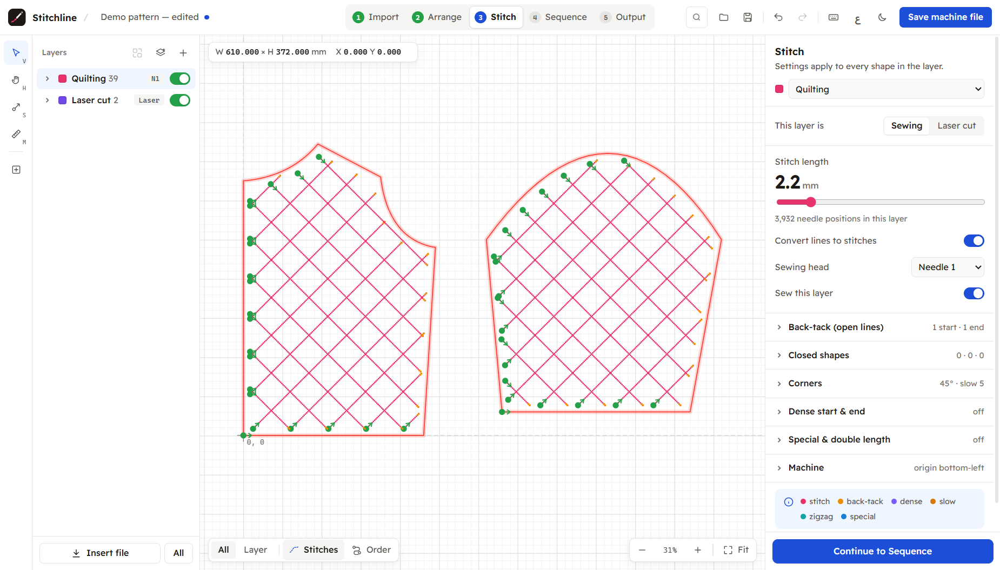
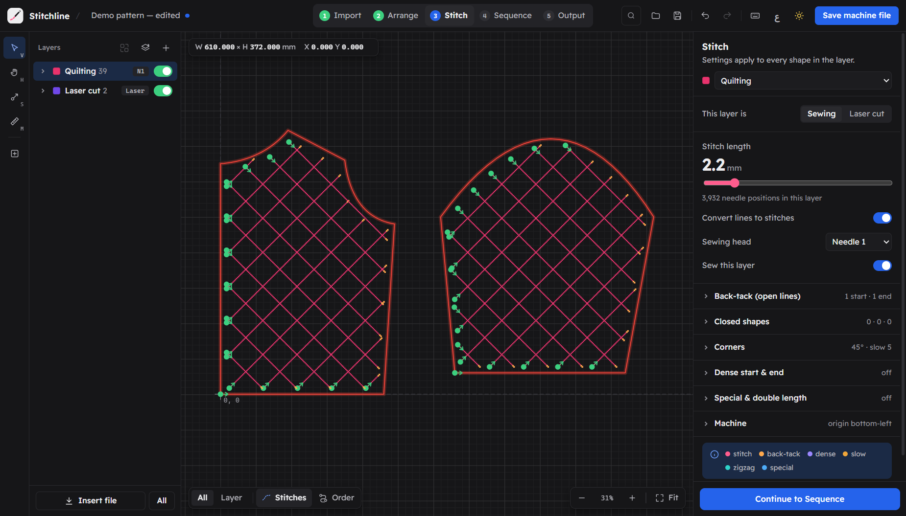
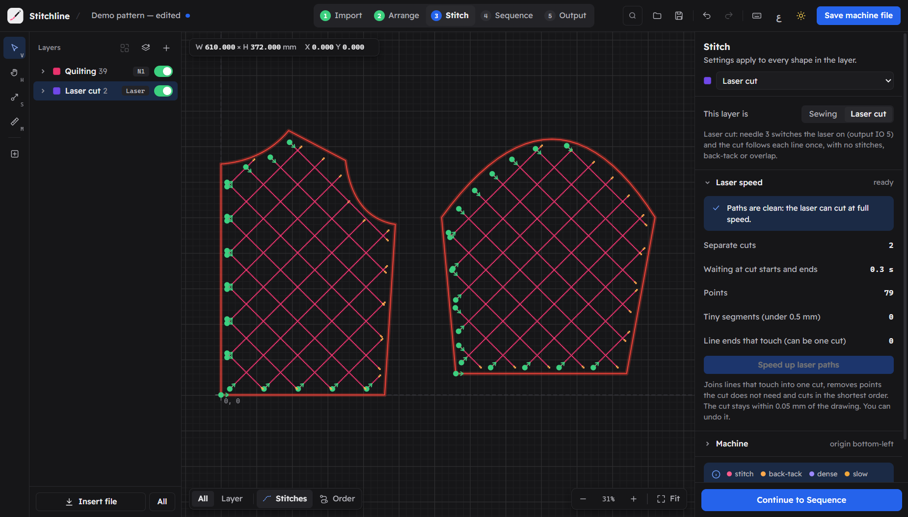
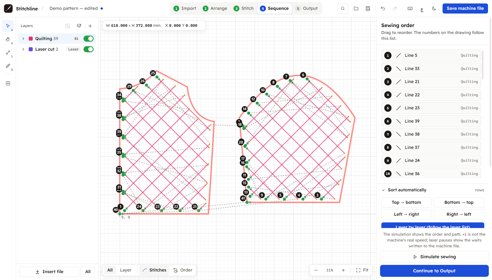
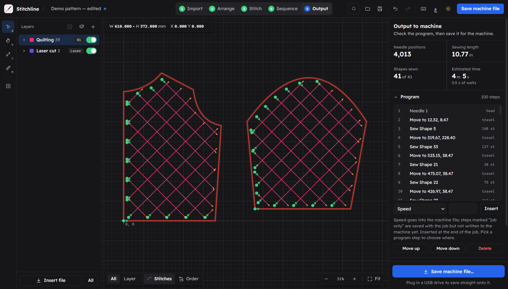
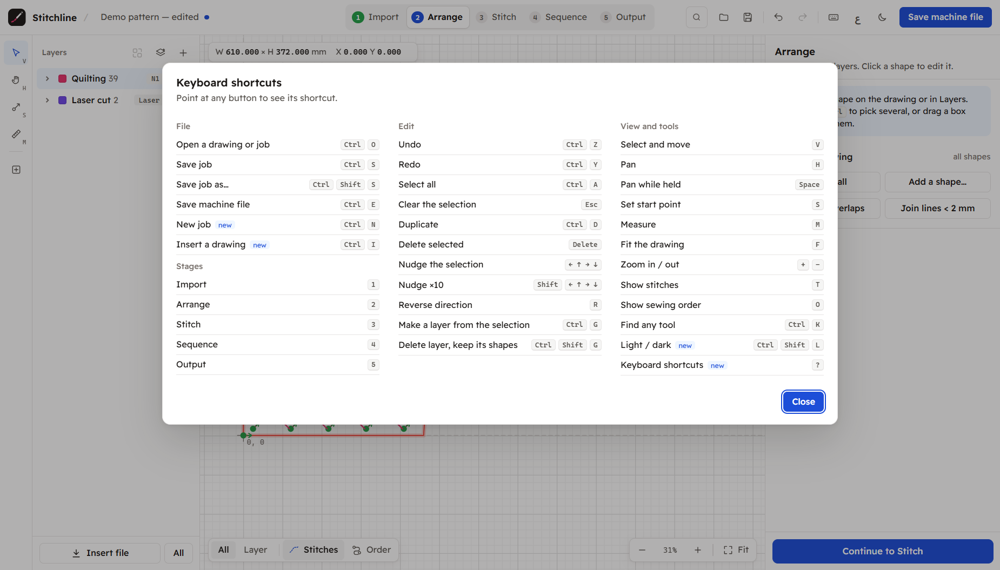

<p align="center"></p>

<h1 align="center">Stitchline</h1>

<p align="center">Pattern sewing and laser cutting jobs for SLW sewing machines · Windows · English and Arabic</p>



A Windows desktop app for pattern sewing machines that read **SLW** machine files (the format of the
"Sew_Soft" pattern-sewing CAD, including machines with a laser head on needle 3). Open a drawing, arrange
the shapes, set up stitches or laser cuts, choose the sewing order, and save the SLW file for the machine,
straight onto a USB stick if you like.

- Starts in a simple mode: the layer list (drag to change the sewing order), sewing or laser cut per layer,
  stitch length, the simulation and saving the machine file. Settings › General › Advanced mode shows every tool
- Opens DXF, Illustrator AI, HPGL (PLT / HPGL / PRT), Tajima DST, Barudan DSB and SLW files
- Stitch settings per layer: stitch length, back-tack, closed-shape reinforcement, slow-down and dense stitches at
  corners, zigzag / back-tack / special-length sections, double stitch length
- Laser layers (needle 3) with a check and a one-click fix for paths that would cut slowly
- Sewing order by hand, by rows or columns, or by shortest travel; sewing simulation
- Machine program with user instructions (speed, delays, outputs, Z axis); exports to DXF, PLT, SVG and CSV
- Arabic (default, right to left) and English; light and dark; undo / redo; autosave
- Small and light: a Rust engine and an HTML interface in the WebView2 window built into Windows 10/11
  (installer about 2.5 MB)

The SLW files it writes match those of the original program record for record on the reference drawings in
`reference/` (see Tests).

## Screenshots

| | |
|---|---|
|  |  |
| **Dark theme:** the same job, switched with Ctrl+Shift+L | **Laser layer** (needle 3) and its cutting-speed check |
|  |  |
| **Sequence:** sewing order, sorting and simulation | **Output:** the machine program, statistics and saving the SLW file |



Every button shows its shortcut; `?` or F1 opens the full list. The demo pattern is
`tests/data/drawings/demo.plt` (made by `tests/make_test_drawings.py`).

## Download and install

Build the installer (below) or take it from the repository's Releases if there is one. It installs per user,
needs no administrator rights, and downloads the WebView2 runtime only if Windows lacks it.

## Project layout

```
engine/            stitchline-engine (Rust library): importers, editing, stitches, machine program, SLW writer
  src/session.rs     the app session: every UI action, undo / redo, prefs, autosave, the state the UI draws
  src/machine.rs     SLW records (writer and reader); src/slw_container.rs: the file's outer scrambling
  src/stitches.rs    shapes to needle positions; src/program.rs: machine program and statistics
  src/py.rs          number formatting and math that match the original Python version bit for bit
  src/bin/cli.rs     test driver: runs a script of UI actions and prints the replies
  tests/parity.rs    SLW parity tests
src-tauri/         the desktop app (Tauri 2): window, native file dialogs, the two commands the UI calls
ui/                the interface: index.html, app.css, app.js, i18n.js (Arabic), fonts/ (Thmanyah Sans for Arabic, Readex Pro for Latin)
reference/         drawings and the SLW files the original program saved from them
tests/             test data, Python comparison scripts, helpers to drive the running window
build.ps1          builds the installer
```

The UI calls `fetch('/api/<action>')` with JSON; a script injected before the page loads (`FETCH_SHIM` in
`src-tauri/src/main.rs`) turns those calls into the Tauri commands `api` and `upload` (dropped files), which run
`Session::handle` in the engine and return the new state as JSON. Messages are English; `ui/i18n.js`
translates them and every label into Arabic.

Prefs and the autosave are kept in `%APPDATA%\Stitchline` (or `%STITCHLINE_HOME%`, which tests use).

## Build

Windows 10/11 with:

- Rust through rustup, toolchain `stable-x86_64-pc-windows-gnu`
- Node.js (for the Tauri CLI: `npm install`)
- MinGW binutils (`as`, `dlltool`, `windres`) for the GNU toolchain:
  `winget install BrechtSanders.WinLibs.POSIX.MSVCRT --scope user`

```
powershell -ExecutionPolicy Bypass -File build.ps1          # installer
powershell -ExecutionPolicy Bypass -File build.ps1 -Test    # engine tests first
```

Output: `target\release\bundle\nsis\Stitchline_1.0.0_x64-setup.exe`. `build.ps1` puts the MinGW tools on
PATH and links with Rust's own bundled gcc (MinGW's gcc adds a second application manifest that clashes with
Tauri's).

For a development build: `cargo build -p stitchline` (the window loads `ui/` built into the exe), or
`tests/dev_run.ps1`, which also starts it on a fresh test profile with DevTools on port 9333.

## Tests

```
cargo test -p stitchline-engine
```

- **Original program:** every case in `reference/parity` (14) and `reference/test.dxf`: the SLW records
  Stitchline writes must equal the original program's (the time-stamped key record excepted; positions may
  differ by 10 micrometres where the original rounds differently).
- **Python version:** the same cases must be identical byte for byte, key record included, to the SLW files of
  the earlier Python version of Stitchline (`tests/data/parity_python.json`).

Stitchline was first written in Python; this Rust version reproduces it exactly. Rust's own `sin()` differs
from Python's in the last bit for about 14% of inputs, so the engine calls the same C runtime functions
(`ucrtbase.dll`) and ports CPython's `hypot`, `sum` and rounding (`engine/src/py.rs`).

With the Python version at hand (not part of this repository; set `STITCHLINE_PY_APP` to its folder),
`tests/compare_with_python.py` runs 31 scenarios through both and compares every reply and every file they
write; `tests/dump_python_parity.py` regenerates `tests/data/parity_python.json`. `tests/make_test_drawings.py`
writes the synthetic DXF / DST / DSB / AI / HPGL files in `tests/data/drawings`.

## Licence

MIT, see `LICENSE`. The Readex Pro font in `ui/fonts` is under the SIL Open Font License
(`ui/fonts/ReadexPro-OFL.txt`). Thmanyah Sans (the Arabic UI font) is free to use and ships
unmodified; its designer asks that it not be edited (`ui/fonts/ThmanyahSans-LICENSE.txt`).
